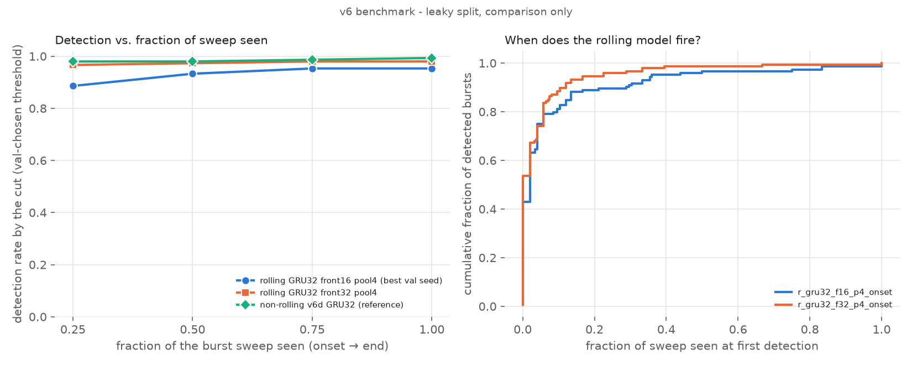

# Rolling (causal) RNN — P(FRB | data up to t) on the original v6 split (2026-10-15)

**v6 benchmark - leaky split, comparison only.** Definitions, orientation and the onset recovery are in `results/NOTES_roll.md`. Per-run rows:
`results/v7r_runs.csv`; run JSONs: `results/runs_roll/`; weights: `results/models_roll/`.

* **Input:** physical high-frequency-first order (v6 time axis reversed); causal time max-pool ×p;
  one time bin (256 channels) per step.
* **Model:** Conv1D(k1) front end → unidirectional LSTM/GRU, return_sequences → per-step head → sigmoid.
* **Labels (default "onset"):** noise 0 at every step; FRB 0 before the recovered onset, 1 from onset on.
* **Excluded:** the 36/10/5 FRB-labelled samples that are pixel-identical to noise (no burst).
  So test = 303 patches and the patch ceiling is 1.0 here, not 0.9838.
* **Patch score = max over t of P_t.**
* **Threshold:** "@thr" uses the lowest threshold whose VAL patch false-alarm rate is ≤ 1 %;
  "@0.5" uses a fixed 0.5.
* **Latency:** time bins (0.655 ms) from the recovered onset to the first step with P ≥ thr;
  negative = before the recovered onset. The onset itself is uncertain by a few bins.
* **Streaming:** every model was checked one bin at a time with carried state against the batch
  output (max |diff| ≤ 1.2e-7, asserted < 1e-5).
* **Runs:** 11 (6 variants + 2 extra seeds each for the top 2 + GRU with front end 32), all seed
  attempts = 1, no collapses.

## Result
* **Best: GRU32, Conv1D(16) front end, time pool ×4.**
  * 9,457 params, 9,232 MACs per step, 64 steps per 168 ms patch.
  * Patch accuracy at the val-chosen 1 % FA threshold **0.990 ± 0.005** (3 seeds).
  * Per-step AUC 0.986 ± 0.000.
  * Median detection latency ≈ 0 bins after the recovered onset (−4…+4, i.e. within one pooled
    step).
* **GRU beats LSTM** at equal or smaller size. LSTM64 is less stable across seeds.
* **Pooling ×4 beats no pooling:** 256 steps learns much worse (per-step AUC 0.90).
* **Window labels** give the best per-step AUC (0.990) but poorly calibrated patch scores at 0.5.
* **Caveats, as for every v6 number:**
  * The memorisation probe (noise accuracy with invisible noise added) is 0.61–0.86: partial
    memorisation of the 5 noise images.
  * v6 noise is 5 images, so FA rates are optimistic.

v6 benchmark - leaky split, comparison only

| model | run_ids | params | MACs/step | steps | per-step AUC | patch acc @thr | patch recall @thr | patch acc @0.5 | precision @0.5 | recall @0.5 | F1 @0.5 | patch AUC | recall@1%FPR | latency median (bins) | latency p90 (bins) | probe noise acc @thr | lookup | max stream diff |
|---|---|---|---|---|---|---|---|---|---|---|---|---|---|---|---|---|---|---|
| GRU32, front 16, pool ×4 (best) | `r_gru32_f16_p4_onset`, `r_gru32_f16_p4_onset_s142`, `r_gru32_f16_p4_onset_s242` | 9,457 | 9,232 | 64 | 0.986 ± 0.000 | 0.990 ± 0.005 | 0.980 ± 0.009 | 0.959 ± 0.041 | 0.947 ± 0.075 | 0.980 ± 0.009 | 0.961 ± 0.038 | 0.991 ± 0.005 | 0.980 ± 0.009 | 0.0 ± 3.3 | 16.0 ± 8.6 | 0.677 ± 0.056 | 0.984 | 1.2e-07 |
| LSTM64, front 16, pool ×4 | `r_lstm64_f16_p4_onset`, `r_lstm64_f16_p4_onset_s142`, `r_lstm64_f16_p4_onset_s242` | 25,905 | 25,616 | 64 | 0.951 ± 0.027 | 0.925 ± 0.076 | 0.848 ± 0.155 | 0.803 ± 0.080 | 0.727 ± 0.087 | 0.993 ± 0.005 | 0.836 ± 0.057 | 0.952 ± 0.052 | 0.848 ± 0.155 | 4.0 ± 0.0 | 56.4 ± 14.6 | 0.725 ± 0.065 | 0.984 | 1.2e-07 |
| GRU32, front 32, pool ×4 | `r_gru32_f32_p4_onset` | 15,105 | 14,864 | 64 | 0.992 | 0.993 | 0.987 | 0.983 | 1.000 | 0.966 | 0.983 | 0.993 | 0.987 | -4.0 | 4.0 | 0.649 | 0.984 | 1.2e-07 |
| LSTM32, front 32, pool ×4 | `r_lstm32_f32_p4_onset` | 17,089 | 16,912 | 64 | 0.968 | 0.990 | 0.980 | 0.904 | 0.841 | 0.993 | 0.911 | 0.995 | 0.980 | 8.0 | 164.0 | 0.753 | 0.984 | 8.9e-08 |
| LSTM32, front 16, pool ×4 (base) | `r_lstm32_f16_p4_onset` | 10,929 | 10,768 | 64 | 0.946 | 0.964 | 0.926 | 0.802 | 0.713 | 1.000 | 0.832 | 0.985 | 0.926 | 32.0 | 192.0 | 0.857 | 0.984 | 1.2e-07 |
| LSTM32, front 16, pool ×4, WINDOW label | `r_lstm32_f16_p4_window` | 10,929 | 10,768 | 64 | 0.990 | 0.974 | 0.946 | 0.594 | 0.548 | 1.000 | 0.708 | 0.980 | 0.946 | 0.0 | 8.0 | 0.812 | 0.984 | 1.2e-07 |
| LSTM32, front 16, no pooling | `r_lstm32_f16_p1_onset` | 10,929 | 10,768 | 256 | 0.904 | 0.822 | 0.638 | 0.591 | 0.546 | 0.993 | 0.705 | 0.862 | 0.638 | 51.0 | 87.6 | 0.818 | 0.984 | 1.2e-07 |

## Stage 2 — mid-burst tests (`scripts/roll_midburst.py`; `results/v7r_midburst.csv`, `v7r_shift.csv`, `fig_roll_midburst.png`)

**v6 benchmark - leaky split, comparison only.**
* Test set: 149 real-burst test FRBs (the 5 no-burst samples excluded) and 154 test noise patches.
* Thresholds: each model's val-chosen 1 % FA threshold.
* S/N proxy: the sweep-track score (v6 stores no S/N).
* Reference: the non-rolling v6d GRU `d_c16_p16_gru32_d32_s42`. It gives one P per patch, so for it
  "by cut" = padded-patch decision.

**Headline**
* **25 % of the sweep is enough.** The best rolling GRU (front 32) detects **96.6 %** by the 25 % cut
  (98.0 % by 75 %). The front-16 GRU detects 88.6 % at 25 % and 95.3 % at 75–100 %.
* **Zero false alarms** on the 154 test noise patches at every horizon.
* **Most detections come almost immediately.** The median fraction of the sweep seen at first
  detection is 0.02 (front 16) / 0.00 (front 32).
* **Caveat: this is mostly not early sweep reading.** **61 % of the injected burst energy in v6 lies
  > 8 bins before the visible sweep onset.** That is the source-file edge/RFI content v6 injected along
  with the sweep (NOTES_v6 §0.1), and the rolling model fires on it.
* **Not position-memorising.**
  * Background alone (the matching noise image at the fitted scale, no burst) fires **0 %** for all
    three models.
  * Moving the burst by +48 bins moves the median first-fire bin from 56 to 104 (+48); the correlation
    of fire time with the shifted onset is 0.53–0.81.
  * Detection drops at +48 (0.84 / 0.91) because part of the burst is pushed off the end of the patch.
  * The non-rolling reference is unaffected by shifts: 0.97–1.00.

### Detection vs fraction of sweep seen (all S/N)
| model | run_id | thr | fraction | S/N bin | n | P at cut (median) | det by cut | det, noise-padded | det, stream | FA on noise by cut | FA on noise, whole patch |
|---|---|---|---|---|---|---|---|---|---|---|---|
| rolling GRU32 front16 pool4 (best val seed) | `r_gru32_f16_p4_onset` | 0.431 | 0.25 | all | 149 | 0.964 | 0.886 | 0.966 | 0.966 | 0.000 | 0.000 |
| rolling GRU32 front16 pool4 (best val seed) | `r_gru32_f16_p4_onset` | 0.431 | 0.50 | all | 149 | 0.977 | 0.933 | 0.966 | 0.966 | 0.000 | 0.000 |
| rolling GRU32 front16 pool4 (best val seed) | `r_gru32_f16_p4_onset` | 0.431 | 0.75 | all | 149 | 0.984 | 0.953 | 0.966 | 0.966 | 0.000 | 0.000 |
| rolling GRU32 front16 pool4 (best val seed) | `r_gru32_f16_p4_onset` | 0.431 | 1.00 | all | 149 | 0.988 | 0.953 | 0.966 | 0.966 | 0.000 | 0.000 |
| rolling GRU32 front32 pool4 | `r_gru32_f32_p4_onset` | 0.249 | 0.25 | all | 149 | 0.989 | 0.966 | 0.980 | 0.987 | 0.000 | 0.000 |
| rolling GRU32 front32 pool4 | `r_gru32_f32_p4_onset` | 0.249 | 0.50 | all | 149 | 0.992 | 0.973 | 0.980 | 0.987 | 0.000 | 0.000 |
| rolling GRU32 front32 pool4 | `r_gru32_f32_p4_onset` | 0.249 | 0.75 | all | 149 | 0.994 | 0.980 | 0.987 | 0.987 | 0.000 | 0.000 |
| rolling GRU32 front32 pool4 | `r_gru32_f32_p4_onset` | 0.249 | 1.00 | all | 149 | 0.994 | 0.980 | 0.987 | 0.987 | 0.000 | 0.000 |
| non-rolling v6d GRU32 (reference) | `d_c16_p16_gru32_d32_s42` | 0.128 | 0.25 | all | 149 | 1.000 | 0.980 | 0.980 | 1.000 | 0.000 | 0.000 |
| non-rolling v6d GRU32 (reference) | `d_c16_p16_gru32_d32_s42` | 0.128 | 0.50 | all | 149 | 1.000 | 0.980 | 0.980 | 1.000 | 0.000 | 0.000 |
| non-rolling v6d GRU32 (reference) | `d_c16_p16_gru32_d32_s42` | 0.128 | 0.75 | all | 149 | 1.000 | 0.987 | 0.987 | 1.000 | 0.000 | 0.000 |
| non-rolling v6d GRU32 (reference) | `d_c16_p16_gru32_d32_s42` | 0.128 | 1.00 | all | 149 | 1.000 | 0.993 | 0.993 | 1.000 | 0.000 | 0.000 |

### Per S/N bin (track-score proxy)
| model | run_id | thr | fraction | S/N bin | n | P at cut (median) | det by cut | det, noise-padded | det, stream | FA on noise by cut | FA on noise, whole patch |
|---|---|---|---|---|---|---|---|---|---|---|---|
| rolling GRU32 front16 pool4 (best val seed) | `r_gru32_f16_p4_onset` | 0.431 | 0.25 | <7 | 20 | 0.800 | 0.750 | 1.000 | 1.000 | 0.000 | 0.000 |
| rolling GRU32 front16 pool4 (best val seed) | `r_gru32_f16_p4_onset` | 0.431 | 0.25 | 7-15 | 12 | 0.920 | 0.917 | 1.000 | 1.000 | 0.000 | 0.000 |
| rolling GRU32 front16 pool4 (best val seed) | `r_gru32_f16_p4_onset` | 0.431 | 0.25 | >15 | 117 | 0.976 | 0.906 | 0.957 | 0.957 | 0.000 | 0.000 |
| rolling GRU32 front16 pool4 (best val seed) | `r_gru32_f16_p4_onset` | 0.431 | 0.50 | <7 | 20 | 0.826 | 0.800 | 1.000 | 1.000 | 0.000 | 0.000 |
| rolling GRU32 front16 pool4 (best val seed) | `r_gru32_f16_p4_onset` | 0.431 | 0.50 | 7-15 | 12 | 0.932 | 1.000 | 1.000 | 1.000 | 0.000 | 0.000 |
| rolling GRU32 front16 pool4 (best val seed) | `r_gru32_f16_p4_onset` | 0.431 | 0.50 | >15 | 117 | 0.986 | 0.949 | 0.957 | 0.957 | 0.000 | 0.000 |
| rolling GRU32 front16 pool4 (best val seed) | `r_gru32_f16_p4_onset` | 0.431 | 0.75 | <7 | 20 | 0.902 | 0.900 | 1.000 | 1.000 | 0.000 | 0.000 |
| rolling GRU32 front16 pool4 (best val seed) | `r_gru32_f16_p4_onset` | 0.431 | 0.75 | 7-15 | 12 | 0.964 | 1.000 | 1.000 | 1.000 | 0.000 | 0.000 |
| rolling GRU32 front16 pool4 (best val seed) | `r_gru32_f16_p4_onset` | 0.431 | 0.75 | >15 | 117 | 0.990 | 0.957 | 0.957 | 0.957 | 0.000 | 0.000 |
| rolling GRU32 front16 pool4 (best val seed) | `r_gru32_f16_p4_onset` | 0.431 | 1.00 | <7 | 20 | 0.926 | 0.900 | 1.000 | 1.000 | 0.000 | 0.000 |
| rolling GRU32 front16 pool4 (best val seed) | `r_gru32_f16_p4_onset` | 0.431 | 1.00 | 7-15 | 12 | 0.981 | 1.000 | 1.000 | 1.000 | 0.000 | 0.000 |
| rolling GRU32 front16 pool4 (best val seed) | `r_gru32_f16_p4_onset` | 0.431 | 1.00 | >15 | 117 | 0.991 | 0.957 | 0.957 | 0.957 | 0.000 | 0.000 |
| rolling GRU32 front32 pool4 | `r_gru32_f32_p4_onset` | 0.249 | 0.25 | <7 | 20 | 0.835 | 0.950 | 1.000 | 1.000 | 0.000 | 0.000 |
| rolling GRU32 front32 pool4 | `r_gru32_f32_p4_onset` | 0.249 | 0.25 | 7-15 | 12 | 0.938 | 0.917 | 1.000 | 1.000 | 0.000 | 0.000 |
| rolling GRU32 front32 pool4 | `r_gru32_f32_p4_onset` | 0.249 | 0.25 | >15 | 117 | 0.994 | 0.974 | 0.974 | 0.983 | 0.000 | 0.000 |
| rolling GRU32 front32 pool4 | `r_gru32_f32_p4_onset` | 0.249 | 0.50 | <7 | 20 | 0.874 | 0.950 | 1.000 | 1.000 | 0.000 | 0.000 |
| rolling GRU32 front32 pool4 | `r_gru32_f32_p4_onset` | 0.249 | 0.50 | 7-15 | 12 | 0.965 | 1.000 | 1.000 | 1.000 | 0.000 | 0.000 |
| rolling GRU32 front32 pool4 | `r_gru32_f32_p4_onset` | 0.249 | 0.50 | >15 | 117 | 0.995 | 0.974 | 0.974 | 0.983 | 0.000 | 0.000 |
| rolling GRU32 front32 pool4 | `r_gru32_f32_p4_onset` | 0.249 | 0.75 | <7 | 20 | 0.901 | 1.000 | 1.000 | 1.000 | 0.000 | 0.000 |
| rolling GRU32 front32 pool4 | `r_gru32_f32_p4_onset` | 0.249 | 0.75 | 7-15 | 12 | 0.979 | 1.000 | 1.000 | 1.000 | 0.000 | 0.000 |
| rolling GRU32 front32 pool4 | `r_gru32_f32_p4_onset` | 0.249 | 0.75 | >15 | 117 | 0.996 | 0.974 | 0.983 | 0.983 | 0.000 | 0.000 |
| rolling GRU32 front32 pool4 | `r_gru32_f32_p4_onset` | 0.249 | 1.00 | <7 | 20 | 0.926 | 1.000 | 1.000 | 1.000 | 0.000 | 0.000 |
| rolling GRU32 front32 pool4 | `r_gru32_f32_p4_onset` | 0.249 | 1.00 | 7-15 | 12 | 0.989 | 1.000 | 1.000 | 1.000 | 0.000 | 0.000 |
| rolling GRU32 front32 pool4 | `r_gru32_f32_p4_onset` | 0.249 | 1.00 | >15 | 117 | 0.996 | 0.974 | 0.983 | 0.983 | 0.000 | 0.000 |
| non-rolling v6d GRU32 (reference) | `d_c16_p16_gru32_d32_s42` | 0.128 | 0.25 | <7 | 20 | 0.999 | 1.000 | 1.000 | 1.000 | 0.000 | 0.000 |
| non-rolling v6d GRU32 (reference) | `d_c16_p16_gru32_d32_s42` | 0.128 | 0.25 | 7-15 | 12 | 1.000 | 1.000 | 1.000 | 1.000 | 0.000 | 0.000 |
| non-rolling v6d GRU32 (reference) | `d_c16_p16_gru32_d32_s42` | 0.128 | 0.25 | >15 | 117 | 1.000 | 0.974 | 0.974 | 1.000 | 0.000 | 0.000 |
| non-rolling v6d GRU32 (reference) | `d_c16_p16_gru32_d32_s42` | 0.128 | 0.50 | <7 | 20 | 0.999 | 1.000 | 1.000 | 1.000 | 0.000 | 0.000 |
| non-rolling v6d GRU32 (reference) | `d_c16_p16_gru32_d32_s42` | 0.128 | 0.50 | 7-15 | 12 | 1.000 | 1.000 | 1.000 | 1.000 | 0.000 | 0.000 |
| non-rolling v6d GRU32 (reference) | `d_c16_p16_gru32_d32_s42` | 0.128 | 0.50 | >15 | 117 | 1.000 | 0.974 | 0.974 | 1.000 | 0.000 | 0.000 |
| non-rolling v6d GRU32 (reference) | `d_c16_p16_gru32_d32_s42` | 0.128 | 0.75 | <7 | 20 | 0.999 | 1.000 | 1.000 | 1.000 | 0.000 | 0.000 |
| non-rolling v6d GRU32 (reference) | `d_c16_p16_gru32_d32_s42` | 0.128 | 0.75 | 7-15 | 12 | 1.000 | 1.000 | 1.000 | 1.000 | 0.000 | 0.000 |
| non-rolling v6d GRU32 (reference) | `d_c16_p16_gru32_d32_s42` | 0.128 | 0.75 | >15 | 117 | 1.000 | 0.983 | 0.983 | 1.000 | 0.000 | 0.000 |
| non-rolling v6d GRU32 (reference) | `d_c16_p16_gru32_d32_s42` | 0.128 | 1.00 | <7 | 20 | 0.999 | 1.000 | 1.000 | 1.000 | 0.000 | 0.000 |
| non-rolling v6d GRU32 (reference) | `d_c16_p16_gru32_d32_s42` | 0.128 | 1.00 | 7-15 | 12 | 1.000 | 1.000 | 1.000 | 1.000 | 0.000 | 0.000 |
| non-rolling v6d GRU32 (reference) | `d_c16_p16_gru32_d32_s42` | 0.128 | 1.00 | >15 | 117 | 1.000 | 0.991 | 0.991 | 1.000 | 0.000 | 0.000 |

### Shift test (burst moved on its own background; physical frame)
| model | run_id | shift (bins) | n | detection rate | median latency vs shifted onset (bins) |
|---|---|---|---|---|---|
| rolling GRU32 front16 pool4 (best val seed) | `r_gru32_f16_p4_onset` | -48 | 149 | 0.953 | 46 |
| rolling GRU32 front16 pool4 (best val seed) | `r_gru32_f16_p4_onset` | -24 | 149 | 0.966 | 22 |
| rolling GRU32 front16 pool4 (best val seed) | `r_gru32_f16_p4_onset` | +0 | 149 | 0.966 | -2 |
| rolling GRU32 front16 pool4 (best val seed) | `r_gru32_f16_p4_onset` | +24 | 149 | 0.933 | -21 |
| rolling GRU32 front16 pool4 (best val seed) | `r_gru32_f16_p4_onset` | +48 | 149 | 0.839 | -41 |
| rolling GRU32 front32 pool4 | `r_gru32_f32_p4_onset` | -48 | 149 | 0.973 | 46 |
| rolling GRU32 front32 pool4 | `r_gru32_f32_p4_onset` | -24 | 149 | 0.987 | 22 |
| rolling GRU32 front32 pool4 | `r_gru32_f32_p4_onset` | +0 | 149 | 0.987 | -4 |
| rolling GRU32 front32 pool4 | `r_gru32_f32_p4_onset` | +24 | 149 | 0.980 | -24 |
| rolling GRU32 front32 pool4 | `r_gru32_f32_p4_onset` | +48 | 149 | 0.913 | -42 |
| non-rolling v6d GRU32 (reference) | `d_c16_p16_gru32_d32_s42` | -48 | 149 | 0.973 | — |
| non-rolling v6d GRU32 (reference) | `d_c16_p16_gru32_d32_s42` | -24 | 149 | 0.987 | — |
| non-rolling v6d GRU32 (reference) | `d_c16_p16_gru32_d32_s42` | +0 | 149 | 1.000 | — |
| non-rolling v6d GRU32 (reference) | `d_c16_p16_gru32_d32_s42` | +24 | 149 | 1.000 | — |
| non-rolling v6d GRU32 (reference) | `d_c16_p16_gru32_d32_s42` | +48 | 149 | 1.000 | — |
